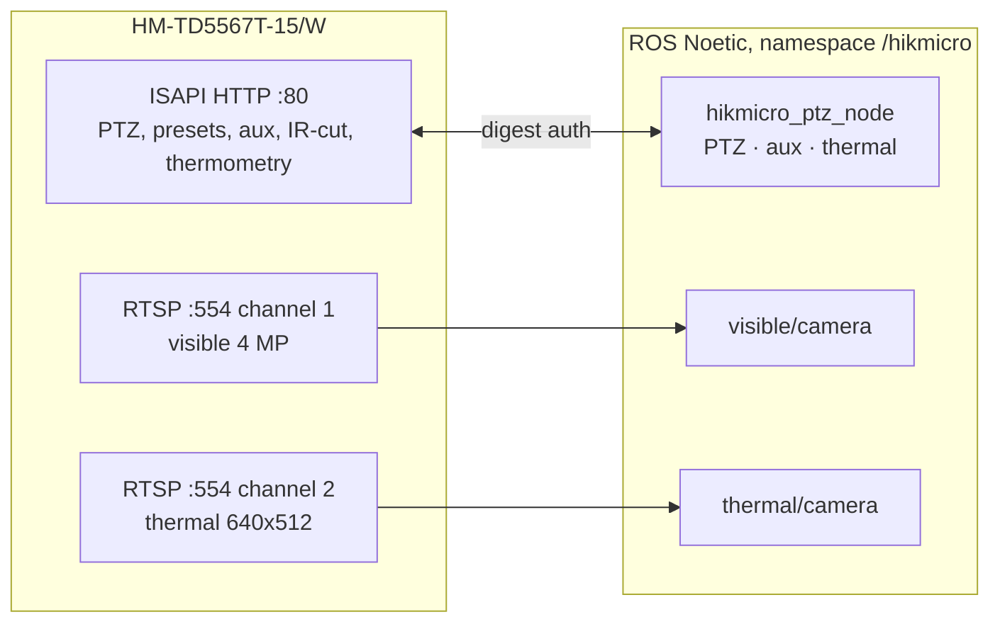

<div align="center">

# hikmicro_driver

**ROS Noetic driver for the HIKMICRO HM-TD5567T bi-spectrum (thermal + visible) PTZ camera
over ISAPI: precise pan/tilt/zoom that tells you when it has arrived, presets, light and wiper,
day/night, RTSP images and temperatures in °C at any pixel. Built for substation inspection on a
Deep Robotics X30.**

[](https://github.com/DarmawanRobotics/hikmicro_ptz_driver/actions/workflows/ci.yml)
[](https://wiki.ros.org/noetic)
[](https://releases.ubuntu.com/20.04/)


[](LICENSE)

[Interface](#interface) · [Has it arrived?](#has-it-arrived) · [Network](#network) ·
[Quick start](#quick-start) · [Usage](#usage) · [Inspection loop](#inspection-loop) ·
[Parameters](#parameters) · [Verify on the real camera](#verify-on-the-real-camera) ·
[Develop](#develop)

</div>

---

**Docs:** [ISAPI summary](docs/isapi.md) · [network setup](docs/network.md) ·
[first run on the camera](docs/first_run.md) · [troubleshooting](docs/troubleshooting.md) ·
[messages](hikmicro_msgs/README.md)

Everything goes over the LAN cable: the camera is controlled with **ISAPI** (HTTP with digest
authentication, *ISAPI Thermography thermal cameras PT series*, which lists the HM-TD5567T-7/15/25
W models) and streams its two sensors over **RTSP**. The ISAPI client, the multipart/thermometry
decoder and the arrival logic have no ROS dependency; the ROS layer is split into PTZ, auxiliary
and thermal interfaces sharing one connection.



## Interface

All names under the launch namespace (`/hikmicro` by default).

**Actions** (`actionlib`)

| Action | Type | |
|---|---|---|
| `ptz/move_to` | `MoveTo` | absolute pan / tilt / zoom; **succeeds only when the camera reports it has arrived**; feedback = position + error |
| `ptz/goto_preset` | `GotoPreset` | call a preset, same arrival check |

**Topics**

| Topic | Type | |
|---|---|---|
| `ptz/state` | `hikmicro_msgs/PtzState` | connected, pan, tilt, zoom, moving (`state_rate`, 10 Hz) |
| `joint_states` | `sensor_msgs/JointState` | pan / tilt joints for `robot_state_publisher` |
| `ptz/cmd_vel` (in) | `geometry_msgs/Twist` | manual: `angular.z` pan, `angular.y` tilt, `linear.z` zoom, −1..1; stops 0.5 s after the last message |
| `thermal/temperature` | `sensor_msgs/Image` | **32FC1, °C per pixel** (pixel-to-pixel thermometry, `radiometric_rate`) |
| `thermal/stats` | `hikmicro_msgs/ThermalStats` | full-frame max / min / mean and where |
| `visible/image_raw` | `sensor_msgs/Image` | RGB stream (channel 1) |
| `thermal/image_raw` | `sensor_msgs/Image` | thermal video (channel 2, palette as set on the camera) |
| `*/image_raw/compressed` | `sensor_msgs/CompressedImage` | via image_transport |

**Services**

| Service | Type | |
|---|---|---|
| `ptz/stop` | `std_srvs/Trigger` | stop any motion (cancels running goals) |
| `ptz/focus` | `std_srvs/Trigger` | one-push autofocus |
| `ptz/set_preset` / `ptz/remove_preset` | `SetPreset` | save the current position as preset `id` / delete it |
| `ptz/get_presets` | `GetPresets` | id, name and position of every preset |
| `aux/light`, `aux/wiper` | `std_srvs/SetBool` | PTZ auxiliaries |
| `aux/set` | `SetAux` | any auxiliary by type: `LIGHT`, `WIPER`, `FAN`, `HEATER` |
| `image/day_night` | `SetDayNight` | IR-cut mode `auto` / `day` / `night` (night = IR light, B/W) |
| `snapshot` | `Snapshot` | full-resolution JPEG of the visible (`0`) or thermal (`1`) sensor |
| `thermal/get_temperature` | `GetTemperature` | °C at a **point**, in a **box** or over the **frame** (pixels or normalized 0..1) |
| `isapi/request` | `RawRequest` | any other ISAPI call (method, path, body) |

Angles are the camera's own: `pan` = azimuth 0..360°, `tilt` = elevation, `zoom` = ratio of the
visible lens. Positions you record with this driver (or as presets) come back exactly the same
way, whatever the sign convention.

## Has it arrived?

The camera only acknowledges a move; it never says "done". `move_to` therefore polls the
position (`absoluteEx`, 0.001° resolution, or `/status`, 0.1°, on firmware without it) and
decides:

| Result `state` | When |
|---|---|
| `reached` | within `pan/tilt_tolerance` (and `zoom_tolerance` if a zoom was given) **and still** for `settle_time` (a sample inside the tolerance while overshooting does not count) |
| `stalled` | still for `stall_time` but outside the tolerance: end stop, limit, obstruction |
| `timeout` | `move_timeout` passed |
| `preempted` | the goal was cancelled; the PTZ is stopped |
| `superseded` | a newer goal, `cmd_vel` or `ptz/stop` took over |
| `error` | the camera refused the command (message has the ISAPI reason) |

Only `reached` succeeds. Pan errors wrap around 0/360°.

## Network

| | |
|---|---|
| camera IP | `192.168.1.64` (factory default); `host:=` in the launch |
| ISAPI | HTTP `80` (`port:=`), digest authentication, user `admin` |
| RTSP | `rtsp://<ip>:554/Streaming/Channels/101` visible, `/201` thermal (`102`/`202` sub streams) |
| channels | 1 = visible (PTZ, day/night, snapshots), 2 = thermal (thermometry) |

Give the robot computer an address in the camera's subnet and check
`curl --digest -u admin:<password> http://<ip>/ISAPI/System/deviceInfo` before launching.

## Quick start

Ubuntu 20.04, ROS Noetic (the X30's computer). Noetic is end-of-life, so `rosdep` needs
`--include-eol-distros`.

```bash
# 1. Source and dependencies
mkdir -p ~/catkin_ws/src && cd ~/catkin_ws/src
git clone https://github.com/DarmawanRobotics/hikmicro_ptz_driver.git
cd ~/catkin_ws
rosdep update --rosdistro noetic --include-eol-distros
rosdep install --from-paths src --ignore-src -y --rosdistro noetic

# 2. Build
catkin_make && source devel/setup.bash      # or: catkin build

# 3. Launch (the password comes from the environment, so roslaunch never prints it)
export HIKMICRO_PASSWORD='<camera password>'
roslaunch hikmicro_driver hikmicro.launch host:=192.168.1.64
#   cameras:=false for control only

# 4. Second terminal
rostopic echo -n 1 /hikmicro/ptz/state
rosrun rqt_image_view rqt_image_view /hikmicro/visible/image_raw
```

## Usage

**Move and wait until it is there**

```bash
rosrun actionlib_tools axclient.py /hikmicro/ptz/move_to      # GUI
rostopic pub -1 /hikmicro/ptz/move_to/goal hikmicro_msgs/MoveToActionGoal \
  "{goal: {pan: 123.4, tilt: -12.5, zoom: 8.0}}"
rostopic echo -n 1 /hikmicro/ptz/move_to/result                 # state: "reached"
```

**Presets**

```bash
rosservice call /hikmicro/ptz/set_preset "{id: 3, name: 'trafo 1 bushing'}"
rosservice call /hikmicro/ptz/get_presets
rostopic pub -1 /hikmicro/ptz/goto_preset/goal hikmicro_msgs/GotoPresetActionGoal \
  "{goal: {id: 3}}"
```

**Light, wiper, day/night, focus**

```bash
rosservice call /hikmicro/aux/light "data: true"
rosservice call /hikmicro/aux/wiper "data: true"
rosservice call /hikmicro/image/day_night "mode: 'night'"   # auto / day / night
rosservice call /hikmicro/ptz/focus
```

**Temperatures**

```bash
# hottest / coldest / mean in a box (thermal pixels), from a frame at most 2 s old
rosservice call /hikmicro/thermal/get_temperature \
  "{mode: 1, x: 300, y: 200, x2: 360, y2: 260}"
# one point, coordinates 0..1 of the image
rosservice call /hikmicro/thermal/get_temperature "{mode: 0, normalized: true, x: 0.5, y: 0.5}"
rostopic echo /hikmicro/thermal/stats              # whole frame, every radiometric frame
```

`thermal/temperature` is the full °C matrix (32FC1) — use it with `cv_bridge` for your own
hot-spot detection. It comes from *pixel-to-pixel thermometry*
(`/ISAPI/Thermal/channels/2/thermometry/jpegPicWithAppendData`); the thermal RTSP video is the
colour-mapped image only.

**Snapshots and everything else**

```bash
rosservice call /hikmicro/snapshot "channel: 0"    # full-resolution visible JPEG
rosservice call /hikmicro/isapi/request "{method: GET, path: /ISAPI/PTZCtrl/channels/1/capabilities}"
```

## Inspection loop

```python
#!/usr/bin/env python3
import actionlib
import rospy
from hikmicro_msgs.msg import MoveToAction, MoveToGoal
from hikmicro_msgs.srv import GetTemperature, Snapshot
from std_srvs.srv import Trigger

POINTS = [  # name, pan, tilt, zoom, box in the thermal image (x1, y1, x2, y2)
    ('trafo 1 bushing A', 123.4, -12.5, 8.0, (300, 200, 360, 260)),
    ('breaker 3 clamp', 141.0, -8.2, 12.0, (280, 180, 380, 300)),
]

rospy.init_node('inspection')
move = actionlib.SimpleActionClient('/hikmicro/ptz/move_to', MoveToAction)
move.wait_for_server()
temperature = rospy.ServiceProxy('/hikmicro/thermal/get_temperature', GetTemperature)
snapshot = rospy.ServiceProxy('/hikmicro/snapshot', Snapshot)
focus = rospy.ServiceProxy('/hikmicro/ptz/focus', Trigger)

for name, pan, tilt, zoom, (x1, y1, x2, y2) in POINTS:
    move.send_goal_and_wait(MoveToGoal(pan=pan, tilt=tilt, zoom=zoom))
    result = move.get_result()
    if not result.reached:
        rospy.logwarn('%s: %s', name, result.message)
        continue
    focus()
    rospy.sleep(1.0)                                   # let the focus settle
    t = temperature(mode=1, x=x1, y=y1, x2=x2, y2=y2, max_age=0.5)
    jpg = snapshot(channel=0)
    rospy.loginfo('%s: max %.1f C at (%d, %d)', name, t.stats.max, t.stats.max_x, t.stats.max_y)
```

## Parameters

[hikmicro.yaml](hikmicro_driver/config/hikmicro.yaml) and [camera.yaml](hikmicro_driver/config/camera.yaml), every
one commented.

**`hikmicro_ptz_node`**

| Parameter | Default | |
|---|---|---|
| `host`, `port`, `https` | `192.168.1.64`, `80`, `false` | from the launch |
| `user`, `password` | `admin`, — | empty password: `$HIKMICRO_PASSWORD` (`password_env`) |
| `ptz_channel`, `visible_channel`, `thermal_channel` | `1`, `1`, `2` | |
| `timeout`, `image_timeout` | `3.0`, `10.0` | s |
| `state_rate` | `10` | Hz, position polling = arrival check rate |
| `pan_tolerance`, `tilt_tolerance`, `zoom_tolerance` | `0.2`, `0.2`, `0.1` | °, °, x |
| `settle_time`, `stall_time`, `move_timeout` | `0.3`, `2.0`, `30` | s |
| `max_speed`, `cmd_vel_timeout` | `60`, `0.5` | `cmd_vel` speed at full deflection (1..100), s |
| `invert_pan`, `invert_tilt`, `invert_zoom` | `false` | `cmd_vel` directions |
| `publish_joint_states`, `pan_joint`, `tilt_joint`, `pan_sign`, `tilt_sign` | `true`, … | joint = sign × device angle |
| `light_aux_id`, `wiper_aux_id` | `0` | 0: the ids the camera lists |
| `radiometric_rate`, `radiometric_max_age` | `1.0`, `2.0` | Hz (0: on request only), s |

**`hikmicro_camera_node`** (`visible/camera`, `thermal/camera`)

| Parameter | Default | |
|---|---|---|
| `channel`, `stream` | `1`/`2`, `1` | URL `rtsp://<host>:<rtsp_port>/Streaming/Channels/<channel>0<stream>`, or `url` |
| `codec`, `decoder` | `auto`, `auto` | `decoder: auto` = Jetson HW (needs `codec`) → GStreamer software → FFmpeg |
| `latency_ms`, `protocols` | `0`, `tcp` | |
| `reconnect_sec`, `timeout_ms` | `1.0`, `5000` | back-off doubles to 30 s |
| `encoding`, `max_fps`, `width`, `height` | `bgr8`, `0`, `0`, `0` | |

## Verify on the real camera

1. **Connection:** `ptz/state` shows `connected: True` and the log the model and firmware.
   `high_precision: True` means `absoluteEx` works (0.001°); otherwise moves use `/status`.
2. **Directions:** move to `pan: 10` then `pan: 20`, and `tilt: 0` then `tilt: 10`: note which way
   the camera turns and set `pan_sign` / `tilt_sign` for the URDF and `invert_*` for `cmd_vel`.
3. **Arrival:** a far move ends `reached` within tolerance; a move past the tilt limit ends
   `stalled` (or `error` if the camera rejects it). Tune `pan/tilt_tolerance` and `settle_time`
   to the inspection distance.
4. **Auxiliaries:** `ptz/get_presets` works and `aux/light` / `aux/wiper` switch the right device;
   `rosservice call /hikmicro/isapi/request "{method: GET, path: /ISAPI/PTZCtrl/channels/1/auxcontrols}"`
   lists the ids if they need `light_aux_id` / `wiper_aux_id`.
5. **Night:** `image/day_night` `night` switches the visible image to B/W with the IR light;
   `auto` lets the camera decide.
6. **Thermometry:** `thermal/stats` arrives at `radiometric_rate`; point a hand at the lens and
   `get_temperature` on it reads 30–36 °C. A `notSupport` error means the firmware has no
   pixel-to-pixel thermometry.
7. **Streams:** `rostopic hz /hikmicro/visible/image_raw` and `/hikmicro/thermal/image_raw`; with
   `decoder: jetson` set `codec` to what the camera encodes (H.264 / H.265).

## Develop

```bash
catkin_make run_tests && catkin_test_results build/test_results --verbose
bash src/hikmicro_ptz_driver/hikmicro_driver/test/smoke_test.sh     # with the workspace sourced
```

- `test_isapi_xml`: builders and parsers against the document's example messages
- `test_radiometric`: multipart parsing, float32 and 16-bit Kelvin matrices, region statistics
- `test_motion`: arrival detection (reached, overshoot, stall, timeout, wrap around 0°)
- `test_camera_fake`: the ISAPI client end to end against [fake_camera.py](hikmicro_driver/test/fake_camera.py)
  (digest auth, a PTZ that moves at finite speed, presets, aux, IR-cut, snapshots, thermometry)
- `test_rtsp`: GStreamer pipelines, decoder order, the capture loop on a local video
- `smoke_test.sh`: `hikmicro.launch` against the fake camera — actions, services, topics; CI runs
  all of it in a `ros:noetic` container

```
hikmicro_ptz_driver/              repo
├── hikmicro_msgs/                PtzState, PtzPreset, ThermalStats, 7 services, MoveTo, GotoPreset
├── hikmicro_driver/
│   ├── include/hikmicro_driver/
│   │   ├── http_client.hpp       libcurl, digest auth (no ROS)
│   │   ├── isapi_xml.hpp         ISAPI messages (no ROS)
│   │   ├── radiometric.hpp       jpegPicWithAppendData, temperature statistics (no ROS)
│   │   ├── motion.hpp            arrival detection (no ROS)
│   │   ├── camera.hpp            HikCamera: the whole camera API (no ROS)
│   │   ├── rtsp_capture.hpp      RTSP capture thread (OpenCV, no ROS)
│   │   └── *_interface.hpp       ROS: PTZ, aux, thermal
│   ├── src/                      hikmicro_node.cpp, camera_node.cpp, ...
│   ├── config/ launch/
│   └── test/
└── docs/                         guides
```

hikmicro_driver is released under the [Apache License 2.0](LICENSE).
